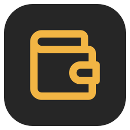
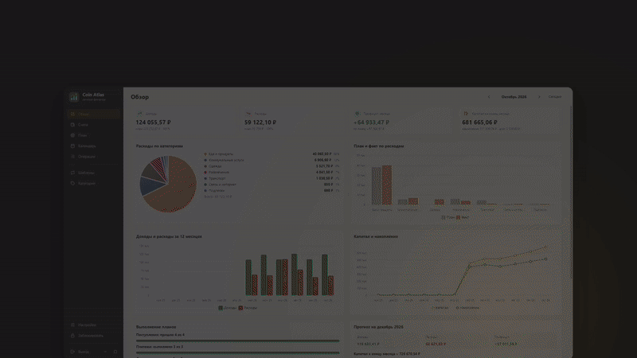

  

<h1 align="center">Coin Atlas</h1>

  <b>План на месяц — за пять минут.</b> 
  Личные финансы на вашем компьютере, без облаков и подписок. 
  Счета, доходы и расходы, планы на месяц, прогноз и графики.

  <a href="https://github.com/SoloMainDeveloper/coin-atlas-app/releases/latest/download/CoinAtlas-windows-x64.zip"><b>⬇ Скачать для Windows</b></a>
  &nbsp;·&nbsp;
  <a href="https://solomaindeveloper.github.io/coin-atlas-app/">Сайт</a>
  &nbsp;·&nbsp;
  <a href="https://github.com/SoloMainDeveloper/coin-atlas-app/releases">Все версии</a>
  &nbsp;·&nbsp;
  <a href="https://github.com/SoloMainDeveloper/coin-atlas-app/issues/new/choose">Сообщить об ошибке</a>

  
  
  

---

## Что умеет

- **Все счета в одном месте** — дебетовые и кредитные карты, наличные, копилки и вклады. Для каждого видно остаток на начало месяца, доходы, расходы, переводы и остаток на конец.
- **Кредитки по-человечески** — долг, лимит, доступный остаток и предупреждение, если долг растёт.
- **Вклады** — проценты считаются по дням, как в банке, с учётом капитализации и даты окончания.
- **План месяца** — лимиты по статьям («Еда — 25 000 ₽») и конкретные платежи («Коммуналка 5 400 ₽, 15-го») с отметкой «оплачено».
- **Плановые доходы** — зарплата, дивиденды, подработка: отмечайте «пришло» или «не пришло».
- **Шаблоны** — повторяющиеся операции добавляются в план одним нажатием.
- **Обзор** — профицит или дефицит, выполнение планов, прогноз на следующий месяц, графики и цели накоплений.
- **Календарь** — что и когда должно прийти или уйти.
- **Пять цветовых тем** — светлые и тёмные.

## Ваши данные — только ваши

- Всё хранится **только на вашем компьютере**, в папке, которую вы выберете. Приложение не обращается к интернету.
- База **зашифрована паролем** (SQLCipher 4, AES-256). Без пароля файл не прочитать.
- Резервная копия делается автоматически раз в день, операции можно выгрузить в CSV для Excel.

> ⚠️ Забытый пароль восстановить невозможно — запишите его.

## Как установить

1. Скачайте **[CoinAtlas-windows-x64.zip](https://github.com/SoloMainDeveloper/coin-atlas-app/releases/latest/download/CoinAtlas-windows-x64.zip)**.
2. Распакуйте в любую папку (например, `C:\Программы\CoinAtlas`).
3. Запустите `CoinAtlas.exe`. Java устанавливать не нужно — она уже внутри.

**Windows показывает «Windows защитил ваш компьютер»?** Так бывает с новыми программами без платной цифровой подписи. Нажмите «Подробнее» → «Выполнить в любом случае».

**Требования:** Windows 10 или 11, 64 бит, около 200 МБ на диске.

## Обновление

Скачайте новую версию и распакуйте поверх старой (или в новую папку). Данные хранятся отдельно и никуда не денутся.

## Вопросы и предложения

Нашли ошибку или есть идея? [Создайте обращение](https://github.com/SoloMainDeveloper/coin-atlas-app/issues/new/choose).

---

© 2026 SoloMainDeveloper. Программа бесплатна для личного использования, исходный код закрыт. Подробнее — в [LICENSE.md](LICENSE.md).
